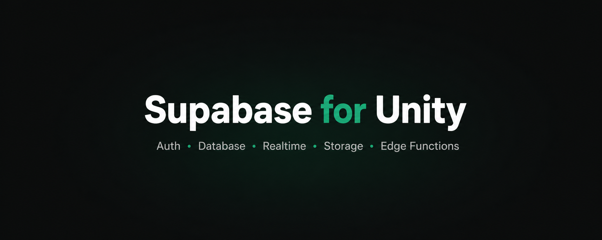

<p align="center">
  
</p>

# Supabase for Unity

An independent Supabase client for Unity 2021.3 and newer, with Auth, Database, Realtime,
Storage, and Edge Functions APIs for WebGL, desktop, and mobile projects.

<p align="center">
  <a href="https://github.com/DorukTan/unity-supabase/releases/tag/v0.3.0"></a>
  <a href="https://github.com/DorukTan/unity-supabase/releases/download/v0.3.0/com.supabaseunity.client-0.3.0.unitypackage"></a>
  <a href="https://github.com/DorukTan/unity-supabase/actions/workflows/package-checks.yml"></a>
  
  <a href="LICENSE.md"></a>
</p>

Version **0.3.0** adds HTTP clients for Editor scripts outside Play mode while preserving
the 0.2.0 runtime API. See the [Editor scripting guide](Packages/com.supabaseunity.client/Documentation~/editor-scripting.md)
for supported operations and lifetime requirements.

## Installation

In Unity 2021.3 or 2022.3, open **Window > Package Manager**. In Unity 6, open
**Window > Package Management > Package Manager**. Select **Add package from git URL**:

```text
https://github.com/DorukTan/unity-supabase.git?path=/Packages/com.supabaseunity.client#v0.3.0
```

UPM installs the Newtonsoft Json.NET dependency automatically. The
[release page](https://github.com/DorukTan/unity-supabase/releases/tag/v0.3.0) also provides:

- A `.tgz` for **Package Manager > Add package from tarball**.
- A `.unitypackage` for **Assets > Import Package > Custom Package**. Install
  `com.unity.nuget.newtonsoft-json` 3.2.1 or newer first.

Choose one distribution; installing both creates duplicate assemblies.

## Configuration

Open **Tools > Supabase > Setup**, create or select a settings asset, then enter the Project
URL and publishable key from the Supabase Dashboard **Connect** dialog. Legacy `anon` keys
are also accepted. The default Data API schema is `public`.

Click **Test Project Connection** to check the URL, key, and network path against Supabase
Auth. It does not test database grants, RLS, or Storage policies. Assign the settings asset
to the component that initializes the client.

A Unity player is a public client. Never ship an `sb_secret_...` key, `service_role` key,
database password, or management token. Use Row Level Security, Storage policies, and
server-side authorization to control access.

## Example

This component reads the `scores` table created by the
[Quickstart SQL](Packages/com.supabaseunity.client/Samples~/Quickstart/setup.sql).
Save it as `Leaderboard.cs`, attach it to a GameObject, and assign the settings asset.

```csharp
using System;
using System.Threading;
using Supabase.Unity;
using UnityEngine;

public sealed class Leaderboard : MonoBehaviour
{
    [SerializeField] private SupabaseSettings settings;
    private SupabaseClient client;
    private CancellationTokenSource lifetime;

    private async void Start()
    {
        if (settings == null)
        {
            Debug.LogError("Assign a SupabaseSettings asset.", this);
            return;
        }

        lifetime = new CancellationTokenSource();
        var token = lifetime.Token;
        try
        {
            client = new SupabaseClient(settings);
            var initialized = await client.InitializeAsync(token);
            token.ThrowIfCancellationRequested();
            if (!initialized.IsSuccess)
            {
                Debug.LogError(initialized.Error, this);
                return;
            }

            var scores = await client.From<ScoreRow>()
                .Select("id,player_name,score")
                .Order("score", ascending: false)
                .Limit(10)
                .GetAsync(token);
            token.ThrowIfCancellationRequested();
            if (scores.IsSuccess)
                Debug.Log("Loaded " + scores.Data.Count + " scores.", this);
            else
                Debug.LogError(scores.Error, this);
        }
        catch (OperationCanceledException)
        {
            // The component's lifetime ended.
        }
        catch (SupabaseConfigurationException exception)
        {
            Debug.LogError(exception.Message, this);
        }
    }

    private void OnDestroy()
    {
        if (lifetime != null) lifetime.Cancel();
        if (client != null) client.Dispose();
        if (lifetime != null) lifetime.Dispose();
    }
}

[Serializable, SupabaseTable("scores")]
public sealed class ScoreRow
{
    [SupabaseColumn("id")] public long Id { get; set; }
    [SupabaseColumn("player_name")] public string PlayerName { get; set; }
    [SupabaseColumn("score")] public int Score { get; set; }
}
```

Network methods return `SupabaseResult` or `SupabaseResult<T>`. Check `IsSuccess` before
reading `Data` or `Error`; cancellation throws `OperationCanceledException`. Use `await` or
the coroutine bridge. Blocking with `.Result`, `.Wait()`, or `.GetAwaiter().GetResult()` can
freeze Unity because requests need the main thread to advance.

For a Database and Realtime example, import **Quickstart** from Package Manager's **Samples**
tab. The `.unitypackage` includes it under `Assets/SupabaseUnity/Samples/Quickstart`.

## Services and Editor tools

| Area | Features |
| --- | --- |
| Auth | Password, OTP, anonymous sign-in, OAuth/PKCE, SSO, MFA, recovery, and sessions |
| Database | Typed PostgREST queries, filters, relationships, pagination, CRUD, counts, CSV, and RPC |
| Realtime | Postgres Changes, Broadcast, Presence, heartbeat, reconnect, and channel rejoin |
| Storage | Upload, download, progress, listing, move, copy, transforms, and signed URLs |
| Functions | Typed and raw Edge Function calls with custom requests and timeouts |
| Editor tools | Setup Assistant, connection checks, model generation, and explicit HTTP clients outside Play mode |

Editor HTTP clients use memory-only session and PKCE stores. They do not support Realtime,
automatic token refresh, or automatic browser authentication. The Model Generator uses an
Editor-only secret for its schema request; that secret is never saved to settings or models.

<a id="platform-support"></a>

## Verification and platform boundaries

The local verification for 0.3.0 covers the following boundaries. A successful build
does not establish live service behavior on a device.

| Target | Recorded verification |
| --- | --- |
| Unity 2021.3.45f2 Editor | EditMode suite and documentation example compilation |
| Unity 2022.3.62f2 Editor | EditMode suite and documentation example compilation |
| Unity 6000.4.8f1 Editor | EditMode suite and clean `.unitypackage` import/compilation |
| WebGL | Smoke player build from the clean package import |
| Windows | Smoke player build from the clean package import |
| Android | Smoke player build from the clean package import |
| iOS | Unity Xcode project export; Xcode compilation, signing, and hardware execution remain separate |
| macOS and Linux players | Not verified by the current release gate |
| Consoles | Unsupported |

The package uses `UnityWebRequest` for HTTP, browser WebSockets on WebGL, and native
WebSockets elsewhere. See [platform notes](Packages/com.supabaseunity.client/Documentation~/platforms.md)
for networking and platform constraints.

GitHub Actions checks package structure, credentials, versions, metadata, WebGL plugin
syntax, and deterministic archives. It does not run Unity. The local release gate runs
the Unity suite, clean import, and platform builds. Tagged release archives must match the
hashes in the attached verification record. See [RELEASING.md](RELEASING.md).

To report live testing, open a
[platform report](https://github.com/DorukTan/unity-supabase/issues/new?template=platform_report.yml)
with the package/Unity version, OS or device, exercised services, and sanitized results.

## Security and session storage

Elevated client keys are rejected, credentialed requests do not follow redirects, and
SDK errors redact keys and tokens. These safeguards do not replace your application's
database grants, RLS, Storage policies, or Edge Function authorization.

Session persistence is off by default. Read the
[session storage guide](Packages/com.supabaseunity.client/Documentation~/session-storage.md)
before enabling it. Native file persistence is unencrypted; use a custom `ISessionStore`
when your application requires operating-system credential protection.

Report vulnerabilities through [private reporting](https://github.com/DorukTan/unity-supabase/security/advisories/new).
Do not include credentials in issues or logs.

## Documentation

- [Getting started](Packages/com.supabaseunity.client/Documentation~/getting-started.md)
- [API guide](Packages/com.supabaseunity.client/Documentation~/api.md)
- [Editor scripting](Packages/com.supabaseunity.client/Documentation~/editor-scripting.md)
- [Troubleshooting](Packages/com.supabaseunity.client/Documentation~/troubleshooting.md)
- [Platform notes](Packages/com.supabaseunity.client/Documentation~/platforms.md)
- [Session storage](Packages/com.supabaseunity.client/Documentation~/session-storage.md)
- [Security model](Packages/com.supabaseunity.client/Documentation~/security.md)
- [Migration guide](Packages/com.supabaseunity.client/Documentation~/migration-0.2.md)
- [Turkish quick start](Packages/com.supabaseunity.client/README.tr.md)
- [Changelog](Packages/com.supabaseunity.client/CHANGELOG.md)

## Contributing and support

Bug reproductions, documentation fixes, platform reports, and focused pull requests are
welcome. Read [CONTRIBUTING.md](CONTRIBUTING.md) and [SUPPORT.md](SUPPORT.md) before opening
an issue or proposing a large change. This is a single-maintainer project with best-effort
support and no SLA.

## License and trademarks

[MIT licensed](LICENSE.md). The package has no paid tier, usage fees, telemetry, or hosted
component. Supabase hosting and third-party services have their own terms and pricing.

This project is not affiliated with or endorsed by Supabase, Inc. or Unity Technologies.
Supabase and Unity names and logos identify compatibility; they remain the property of
their respective owners.
